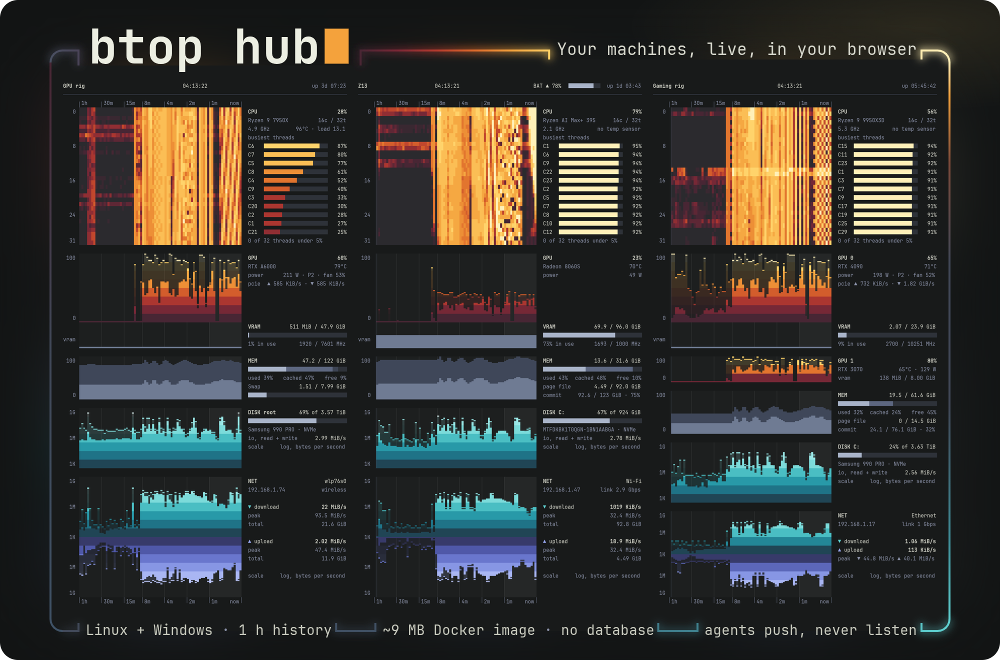
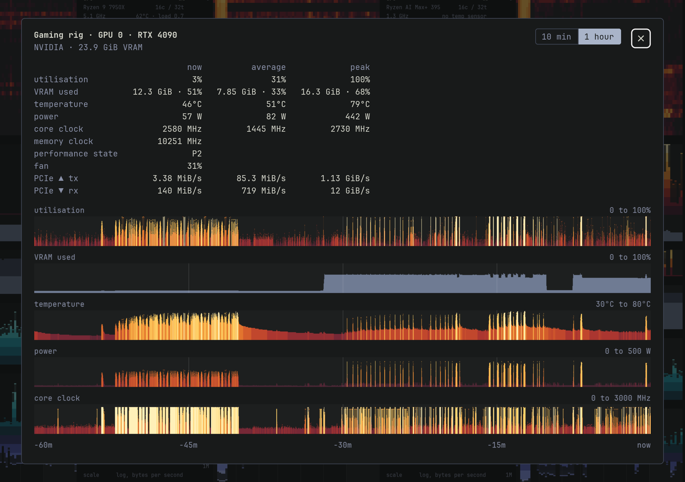

<p align="center">
  
</p>

# btop hub

One web page that shows the live activity of several machines side by side, styled after the
[btop](https://github.com/aristocratos/btop) terminal monitor. A small agent on each Linux or Windows machine samples
once a second and pushes to a hub that runs in Docker on your LAN, and every pane shows that machine's last hour.

## What you get

- **Every machine side by side**, each with an hour of history on a non-linear time axis (1h, 30m, 15m, 8m, 4m, 2m,
  1m, now): a per-thread CPU heat map, GPU busy and VRAM, memory and file cache, and disk I/O and network on log
  scales.
- **Tap for details.** Tap or click any part of a pane for an overlay with averages, peaks and one-second charts.
  Pinch to zoom; the panes fill any screen, and there is a full-screen mode.
- **Small agents for Linux and Windows.** They sample once a second, keep their own last hour and push to the hub
  over one outbound connection; they never listen on a port. GPUs: NVIDIA through NVML, AMD through ADL, others
  through DXGI/PDH on Windows.
- **A small hub.** One Docker image, about 9 MB to pull: `scratch`, non-root, read-only filesystem, no
  capabilities. No database, no outbound requests, and it answers only the networks you allow.

<p align="center">
  
</p>

<sub>Above: the overlay for one GPU over the last hour. Top: the page full screen on a 2560x1600 tablet during the
[light show](#light-show-a-synthetic-load-test) load test ([full-size screenshot](docs/screenshot.png)); the blank
left part of two panes is the time before their agents were installed.</sub>

## Quick start

On the machine that will run the hub (x86-64 Linux with Docker and Compose; everything is built inside Docker):

```sh
git clone https://github.com/cbroker1/btop-hub.git
cd btop-hub
cp .env.example .env                 # then set HUB_BIND (this host's LAN address) and HUB_ALLOW (your network)
docker compose up -d --build
docker exec btop-hub /hub token      # the shared agent token, created on first start
```

The page is at `http://HUB_BIND:28677` for any device in `HUB_ALLOW`. Then [install an agent](#install-an-agent) on
each machine you want on the page, including the hub host if you want to see it; each pane appears as soon as its
agent connects. [Simulated machines](#simulated-machines) fills the page with plausible data if you'd like to see it
before installing anything.

The examples below use the author's setup: a Linux GPU rig that also runs the hub at `192.168.1.74`, plus a Z13
tablet and a gaming rig on Windows. Put your own `HUB_BIND:HUB_PORT` in place of `192.168.1.74:28677`.

## Settings

Settings are in `.env` (start from `.env.example`):

| Variable | Meaning |
|---|---|
| `HUB_BIND` | This host's address on your LAN (here `192.168.1.74`). The port is published only there. |
| `HUB_PORT` | Port on that address (`28677`). |
| `HUB_ALLOW` | Source networks the hub answers, as comma-separated CIDRs (here `192.168.1.0/24`). Published Docker ports bypass ufw, so the hub checks this itself and refuses everything else. |
| `HUB_ORDER` | Pane order, left to right, by machine id. Unlisted machines follow alphabetically. |

If the address comes from DHCP, give the hub host a DHCP reservation so `HUB_BIND` stays valid (the container cannot
start if the address is gone).

<details>
<summary>Build fails with <code>docker-credential-pass: executable file not found</code></summary>

Docker can't pull the base images because `~/.docker/config.json` names a credential helper that isn't installed.
Either install it (`sudo apt install golang-docker-credential-helpers pass`) or remove the `"credsStore": "pass"`
line; for a one-off build, `DOCKER_CONFIG=$(mktemp -d) docker compose build` uses an empty config (anonymous pulls).

</details>

## Install an agent

Get the token first: `docker exec btop-hub /hub token`. The commands use the example hub address,
`192.168.1.74:28677`; put your own `HUB_BIND:HUB_PORT` in its place.

**Windows** (here the gaming rig and the Z13): open **Windows PowerShell as administrator** and run one line (Windows PowerShell 5.1
is enough; nothing else is installed):

```powershell
& ([scriptblock]::Create((New-Object Net.WebClient).DownloadString('http://192.168.1.74:28677/install.ps1'))) -Token 'TOKEN' -Name 'Gaming rig'
```

It downloads `btop-agent.exe` from the hub, checks its SHA-256, installs it in `C:\Program Files\btop-agent`, stores
the token in `C:\ProgramData\btop-agent\agent.json` (readable only by SYSTEM, Administrators and the service), and
registers the `btop-agent` service: automatic (delayed) start, runs as LocalService (LocalSystem with
[`-CpuTemp`](#cpu-temperature-on-windows)), below-normal priority, restarts on failure. It ends by printing a probe (one sample and where each value came from); paste that back if a
pane looks wrong. Re-running upgrades in place. To remove it:

```powershell
& ([scriptblock]::Create((New-Object Net.WebClient).DownloadString('http://192.168.1.74:28677/uninstall.ps1')))
```

Or, from the hub host over SSH (the SSH user must be an administrator; the token is read from the hub and never
shown). The first argument is an ssh destination, such as a `Host` from `~/.ssh/config` (here `tablet` and
`gamingrig`), the second the pane name:

```sh
tools/install-windows-agent.sh tablet Z13
tools/install-windows-agent.sh --cpu-temp gamingrig "Gaming rig"    # -CpuTemp, see below
tools/install-windows-agent.sh --uninstall tablet
```

AMD GPUs (such as the Z13's Radeon 8060S) are read through AMD's driver library, so they show load, clock,
temperature, power and the exact VRAM split, as [btop4win](https://github.com/aristocratos/btop4win) does.

#### CPU temperature on Windows

Windows has no API for the CPU temperature; tools such as HWiNFO load a kernel driver of their own to read it. The
agent finds it without one where the firmware or a driver already offers it: on ASUS laptops (here the Z13) from
the ATK ACPI device that Armoury Crate and G-Helper read (about 0.5 ms of CPU a second), and on AMD APUs whose
graphics driver reports it.

On an AMD Ryzen desktop (here the gaming rig) it can read the CPU's own sensor, Tctl (what HWiNFO shows as "CPU
(Tctl/Tdie)"), through [PawnIO](https://pawnio.eu): the small signed driver LibreHardwareMonitor and FanControl use,
which runs only signed modules, each limited to its job. PawnIO admits only SYSTEM and Administrators, so this is
opt-in: install PawnIO, then run the install command again with `-CpuTemp`. The service then runs as LocalSystem
with every privilege removed except the two it uses (`SeChangeNotifyPrivilege`, `SeCreateGlobalPrivilege`):

```powershell
winget install namazso.PawnIO
& ([scriptblock]::Create((New-Object Net.WebClient).DownloadString('http://192.168.1.74:28677/install.ps1'))) -Token 'TOKEN' -Name 'Gaming rig' -CpuTemp
```

The installer refuses `-CpuTemp` when PawnIO is missing or the CPU is one its module does not read (Intel, or AMD
before Zen), and prints the temperature source the service itself found. Running the install command again
without `-CpuTemp` goes back to LocalService. Anywhere the agent finds no source, the readout says "no temp sensor".

**Linux** (here the GPU rig, which also runs the hub): the agent runs on the host as a systemd service, so the hub's
container needs no host or GPU access.

```sh
curl -fsSL http://192.168.1.74:28677/install.sh | sudo sh -s -- --token TOKEN --name "GPU rig"
curl -fsSL http://192.168.1.74:28677/uninstall.sh | sudo sh      # to remove it
```

The service runs as a throwaway system user (`DynamicUser`), at nice 10 with idle I/O priority, with the token
passed as a systemd credential and the filesystem read-only.

## Add or remove a machine

- **Add:** run the install command on it with a new `-Name`. The machine id is derived from the name (`Gaming rig`
  becomes `gaming-rig`); pass `-Id`/`--id` to choose it. The pane appears as soon as the agent connects. To place it,
  add the id to `HUB_ORDER` in `.env` and run `docker compose up -d`.
- **Remove:** uninstall the agent on that machine, then `docker exec btop-hub /hub forget gaming-rig`. Until you
  forget it, the hub keeps the machine's pane (shown offline) so a sleeping laptop keeps its place.
- **One agent per machine.** If a second agent starts on the same machine with the same id (say the service after a
  hand-started test run), the newer one takes over and the older one stops. Two *different* machines using the
  same id are refused, so they can't overwrite each other; give one of them another `-Name`/`--id`.

## Change the port

Edit `HUB_PORT` in `.env`, then `docker compose up -d`. Agents still point at the old URL: re-run the install command
on each machine with the new URL (it upgrades in place), or edit `"hub"` in its config (`C:\ProgramData\btop-agent\agent.json`,
`/etc/btop-agent/agent.json`) and restart the service.

## Reading the page

- **Time axis.** 80 columns cover the last hour: the left edge is an hour ago, the right edge is now. Ticks sit at
  1h, 30m, 15m, 8m, 4m, 2m, 1m and now; between ticks time is geometric, and the last minute is linear (3.75 s per
  column). Each column shows the mean and the peak of the 1-second samples it covers: the band height is the mean,
  the faint veil and the thin cap above it reach the peak. The caption under each pane says how much time one
  column spans at each end.
- **CPU.** One half-height row per logical thread, coloured by load from dark (idle) through red and orange to pale
  yellow (busy). Beside it, the busiest threads in descending order (as many as fit beside the strip, 11) and how
  many threads are under 5%.
- **GPU, memory.** GPU busy on top, VRAM history under it; memory in use, with the OS file cache stacked above.
- **Disk, network.** Bytes per second on a fixed log scale (1 KiB/s at the baseline, 1 GiB/s at full height);
  download grows up from the centre line, upload down.
- **No data** (before boot, asleep, agent stopped) is left blank in the page colour with a thin rule at its edge;
  it is never drawn as zero. A pane whose agent has been silent for 5 s says "offline, last seen ..." and dims its
  readouts.
- **Alerts** use the orange-red badge only past a threshold: swap or page file at 80%, memory at 90%, disk at 90%,
  GPU at 85 °C. The thresholds are in one block at the top of `web/app.js`.
- **Fitting the screen.** The page picks the arrangement with the biggest characters: all panes side by side, or
  stacked (two on top, one below) when that is bigger, as on a tablet in portrait. All machines are shown together
  while a character is at least 5 device pixels and 3 CSS pixels wide (`MIN_CELL` at the top of `web/app.js`):
  that keeps all three example machines together on the Z13 (2560x1600 at 175%), and a phone on one machine at a
  time. When only one
  fits, dots in the bottom margin say there are more: swipe or use the arrow keys. The panes fill the width, and
  rows stretch to fill the height (up to 1.8 times the design's 8:20 cell, `MAX_ROW`), so there are no empty
  bands; text, bars and badges keep their size and sit centred in the taller rows, and the graphs grow.
- **Text size.** Text is drawn 32% larger than the design's cell (`TEXT_SCALE` at the top of `web/app.js`). The
  readouts keep their layout and the graphs give up the width: the time axis keeps its 80 columns, each a little
  narrower.
- **Zoom.** Pinch with two fingers on a touch screen or touchpad, or use Ctrl + wheel or the + and - keys, up to
  6x. The page redraws at the new size, so a zoomed view stays sharp; it pans with one finger, a mouse drag or the
  wheel. Double-tap or double-click, pinch back out, or press Esc or 0 to return to the whole view. While zoomed,
  a single tap waits a moment (in case it's a double tap) before opening details, and the header doesn't switch
  to one machine.
- **Details.** Tap or click any part of a pane (the CPU, a GPU, memory, disk or network: graph or readout) for an
  overlay with everything the agent reports for that device: the values now, the average and peak over the last
  10 minutes or hour, every CPU thread, and charts of that span at one second per sample, including series the
  panes don't draw (CPU frequency and temperature, GPU temperature, power and clock, disk reads and writes
  separately, swap and commit). It updates live; close it with the X, Esc or a tap outside.
- **One machine.** Tap or click a machine's header row (its name, clock and uptime) to see it alone, at full size;
  again, or Esc or 0, to see all of them. Keys 1-9 jump to a machine. On touch screens a tap on the header while
  the controls are hidden only reveals them (the full-screen button sits over the header's right end).
- **Full screen.** The button in the top-right corner (it appears when the mouse moves or the screen is tapped) or
  the F key. It hides the browser bar and taskbar, which gives the rows more height; the cursor hides when idle.
- `?m=z13` (or `?m=gpu-rig,z13`) shows only the listed machines, for a dedicated display.

## Debugging an agent

```sh
btop-agent --probe [--config agent.json]
```

prints one sample as JSON, the source used for every metric (or why there is none), how long each source took, a
hub/token check and the agent's own CPU and memory. On Windows: `& 'C:\Program Files\btop-agent\btop-agent.exe' --probe --config C:\ProgramData\btop-agent\agent.json`.
The service log is `C:\ProgramData\btop-agent\agent.log` on Windows and `journalctl -u btop-agent` on Linux.

## Simulated machines

`--simulate gpu-rig|z13|gaming-rig` feeds plausible data (with an hour of backfill) shaped like one of the three
example machines, so the page can be checked before a real agent exists. Simulated panes say "simulated" next to the
name. When a real agent with the same id connects, it takes over: the simulated hour is dropped and the simulator
stops by itself.

```sh
curl -fsSLo btop-agent http://192.168.1.74:28677/dist/btop-agent-linux-amd64 && chmod +x btop-agent
./btop-agent --simulate z13 --hub http://192.168.1.74:28677 --token TOKEN --sim-gap 25m,6m
```

## How it works

- **Agent → hub.** One HTTP POST that never ends: the agent writes newline-delimited JSON (a hello, then one sample
  a second); the hub answers the hello with the last sample it already has from this agent run, then sends a
  heartbeat every 5 s. Either side notices a dead peer within about 20 s and the agent reconnects with backoff.
- **No lost hour.** Each agent keeps its own last hour (about 2 MB) and, on reconnect, resends whatever the hub is
  missing. A hub restart therefore loses nothing: the agents backfill it within seconds. An agent restart loses
  nothing either, because the hub still has the hour.
- **One clock.** The hub stamps live samples with its own receive time, so clock differences between machines
  cannot skew the shared axis. Backfilled samples are converted from the agent's clock with the offset measured at
  connect.
- **Hub → page.** `/api/history` returns the hour; `/api/stream` (server-sent events) pushes each new sample. The
  page aggregates the 1-second samples into the 80 columns, redraws once a second, and stops (closing the stream)
  while its tab is hidden.
- **Sources.** Linux: `/proc/stat`, `/proc/meminfo`, `/proc/diskstats`, `/sys/class/net`, k10temp, and NVIDIA's NVML.
  Windows: per-processor times from `NtQuerySystemInformation`, memory and page-file counters, PDH counters for disk
  I/O and CPU speed, the default-route adapter's counters, NVML for NVIDIA cards, and AMD's driver library
  (`atiadlxx.dll`, the same source LibreHardwareMonitor and btop4win use) for AMD GPUs: load, clocks,
  temperature, power and the exact VRAM split. DXGI and the Windows GPU counters are only the fallback for other
  GPUs. No WMI, and no process is started per sample. CPU temperature: k10temp on Linux. Windows has none of its
  own: the agent uses AMD's library where an APU reports it, on ASUS laptops the ATK ACPI device (`\\.\ATKACPI`,
  device 0x00120094: the firmware's CPU temperature, as Armoury Crate and G-Helper show it), and with `-CpuTemp`
  on AMD Ryzen CPUs (family 17h to 1Ah) the PawnIO driver's AMDFamily17 module, which reads Tctl from SMN register
  0x59800 as Linux's k10temp does: one IOCTL a second, made while holding the `Access_PCI` mutex that programs
  reading those registers share. The module is embedded in the agent as published, signed
  (`internal/collect/pawnio`, LGPL-2.1).

## Security

- Published only on `HUB_BIND`, and the hub refuses any source outside `HUB_ALLOW` (loopback excepted, for the
  container's own health check).
- Agents need the shared token; the page and its data need no login (plain HTTP on the LAN).
- The container runs as a non-root user from a `scratch` image with a read-only filesystem, no capabilities,
  `no-new-privileges`, a 64 MB memory limit, a PID limit and a health check. Its only writable path is the
  `hub-data` volume (token and the list of known machines).
- Install scripts verify the agent's SHA-256 before installing it.
- Windows agents run as LocalService. Only with `-CpuTemp` (for PawnIO, which admits only SYSTEM and
  Administrators) do they run as LocalSystem, keeping just `SeChangeNotifyPrivilege` and
  `SeCreateGlobalPrivilege`; the installer refuses it without PawnIO or on a CPU PawnIO's module does not read.

## Resource use

Measured on the machines themselves. Windows agents measure their own CPU from the processor's cycle counter
(Windows' usual tick-based accounting misses short bursts like the agent's entirely) and release start-up-only pages
from their working set ten seconds after starting; each sample carries the agent's CPU and memory, so the hub
always knows what the agents cost.

| What | Budget | Measured |
|---|---|---|
| Image | ≤ 25 MB | 22.2 MB on disk as `docker image ls` reports it (9.1 MB to pull), both agents included |
| Hub (3 agents, 2 viewers) | ≤ 32 MB, ≤ 1% of a core | 14.8 MB RSS, 0.13% of a core over 60 s; about 20 MB with a full hour from four machines |
| Agent, Linux, GPU rig | ≤ 30 MB, ≤ 1% of a core | 0.35% of a core; 22 MB as systemd accounts it (`systemctl status btop-agent`), 33.7 MB RSS: NVIDIA's NVML loads libcuda when it initialises and adds about 21 MB of shared and private pages by itself (the same agent without NVML uses 13.5 MB) |
| Agent, Windows, Z13 | ≤ 30 MB, ≤ 1% of a core | 0.46% of a core, 5.6 MB working set (measured over a minute of streaming) |
| Agent, Windows, gaming rig | ≤ 30 MB, ≤ 1% of a core | 0.20% of a core, 5.9 MB working set |
| Page before history | ≤ 200 KB | 63 KB (41 KB sent compressed), fonts included; zero external requests. History: about 0.4 MB per machine-hour gzipped (1.3 MB for three full hours) |

## Building without Docker Compose

Everything builds in Docker (`Dockerfile`): the hub (static, `scratch` image), the Windows agent (`btop-agent.exe`,
cross-compiled, no runtime to install) and the Linux agent. The hub serves both agents at `/dist/`.

## Light show (a synthetic load test)

`tools/lightshow.sh` puts a varying, time-limited load on this machine and on Windows machines over ssh, so every part of
the page lights up: CPU patterns across the threads, GPU load, memory swelling and shrinking, disk waves, and
network traffic between the machines over ssh. It runs at idle priority, stops by itself (20 minutes by default,
25 at most), installs nothing, and deletes what it copied and wrote.

```sh
tools/lightshow.sh start --hosts tablet,gamingrig   # this machine and two Windows ssh hosts, 20 minutes
tools/lightshow.sh start --duration 5m --local-only --mem local=4G
tools/lightshow.sh status
tools/lightshow.sh stop                  # everything, everywhere, now
```

Without `--hosts` it uses the example setup's ssh hosts, `tablet` and `gamingrig`, and the memory wave on this
machine peaks at 16 GiB unless you pass `--mem local=SIZE`, so lower it on a smaller machine. Options (hosts, memory
and network peaks, leaving out the GPU, disk or network) and exactly what it does to each
machine are in [`tools/lightshow/README.md`](tools/lightshow/README.md).

## Files

| Path | What |
|---|---|
| `cmd/hub`, `internal/hub` | The hub |
| `cmd/agent`, `internal/agent` | The agent: sampling loop, ring buffer, uplink, probe |
| `internal/collect` | Metric sources per OS, the NVIDIA helper and the simulator; `pawnio/` holds the signed PawnIO module the Windows agent embeds (LGPL-2.1, see its `NOTICE`) |
| `internal/nvml` | Minimal NVML binding (no cgo) |
| `internal/platform` | Priority, self-measurement and the Windows service wrapper |
| `web` | The page (`index.html`, `app.js`, `style.css`) and the JetBrains Mono subset (OFL, see `web/fonts/OFL.txt`) |
| `scripts` | Install and uninstall scripts and the systemd unit, served by the hub |
| `tools` | `install-windows-agent.sh`: run the Windows installer over SSH from the hub host; `lightshow.sh` and `lightshow/`: the synthetic load test |
| `design` | The mockups the page reproduces |
| `docs` | The images in this README |
